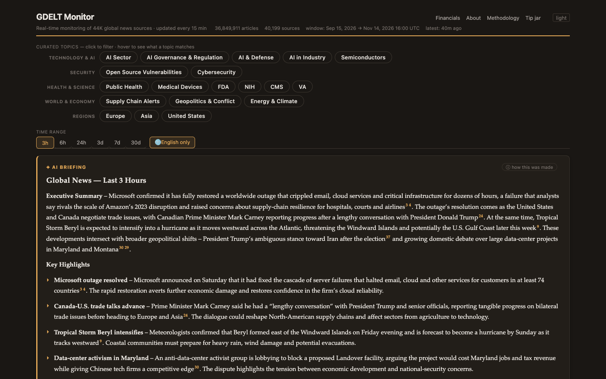
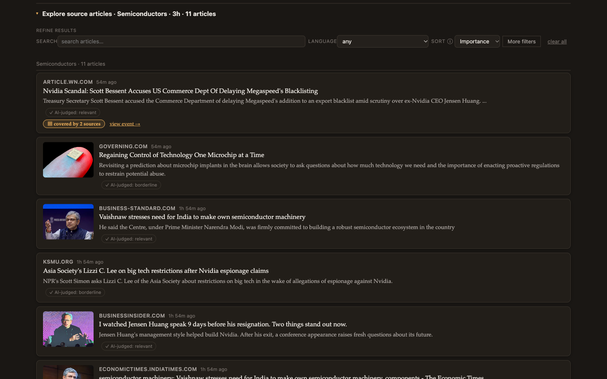

# GDELT Monitor

[](https://github.com/sidscorp/gdelt-events/actions/workflows/tests.yml)

Real-time global news intelligence dashboard. Continuously ingests the GDELT Project's news feed — 44,000+ sources worldwide — de-duplicates it into distinct events, and surfaces the signals that matter through curated topic filters, custom keyword/semantic monitoring, semantic search, and on-demand AI briefings.

Live at [gdeltmonitor.com](https://gdeltmonitor.com)



Curated views filter the feed to one topic. Each article card shows why it matched, and near-duplicate stories roll up into a single event:



Every event gets a shareable permalink that gathers the outlets covering it, with an AI-assisted explanation checked against those sources:


## Features

- **Preset monitoring views**: Medical Device Companies (FDA matcher), Supply Chain Alerts, Semiconductor & Chip Geopolitics, AI & Machine Learning, AI Regulation & Policy, and more.
- **Custom keyword pills**: define keyword sets; the system builds an Aho-Corasick automaton and scans the corpus.
- **Semantic pills + search**: describe what to monitor in natural language; FAISS-indexed embedding similarity (nomic-embed-text, IVF-PQ index).
- **Event clustering**: near-duplicate articles about the same story are rolled up into a single event card with a shareable `/event/<id>` permalink (FAISS candidate gen + exact-cosine re-rank, leader clustering).
- **AI briefings**: on-demand intelligence briefings for any view/time window, generated by Gemini 2.5 Flash (via OpenRouter), streamed (SSE) and cached, with citations back to sources.
- **Installable PWA**: offline app-shell via a service worker; global dark mode.
- **15-minute update cycle**, **60-day rolling window** with automatic pruning.

## Architecture

```
GDELT feeds (every 15 min)
    │  pipeline/
    ▼
Downloader → Parser → DuckDB (~22M articles, 60-day window)
    ├─ Tagger          (Aho-Corasick, keyword patterns)
    ├─ FDA Matcher     (Aho-Corasick, ~8500 companies)
    ├─ Embedder        (nomic-embed-text via Ollama)
    ├─ FAISS index     (IVF-PQ, candidate neighbours)
    └─ Clusterer       (leader clustering → event clusters)
    │  dashboard/  (Flask + Waitress, blueprints)
    ▼
Browser  ←→  routes/ → services (articles.py, briefing.py) → db.py
    ├─ AI briefings  → OpenRouter (Gemini 2.5 Flash)   ─┐
    └─ Auth (Flask-Login, SQLite)                        ├→ Langfuse (cost/latency traces)
```

## Tech stack

| Component | Technology |
|-----------|-----------|
| Database | DuckDB 1.5.1 (analytical) + SQLite (user data) |
| Pattern matching | Aho-Corasick via pyahocorasick |
| Embeddings | nomic-embed-text v1.5 via Ollama |
| Event clustering / search | FAISS IVF-PQ + exact-cosine re-rank |
| AI briefings | Gemini 2.5 Flash via OpenRouter |
| Observability | Langfuse (briefing token/cost/latency traces) |
| Web framework | Flask + Waitress |
| Front-end | Server-rendered Jinja + buildless CSS/JS (no bundler); installable PWA |
| Data source | GDELT Project v2 (GKG) + v3 (GAL) |

## Design decisions

**One writer, many readers.** Ingest is the only process that writes DuckDB; the web
tier opens read-only connections with a statement timeout. The file lock never sits in
a request path, and the cost is freshness: the feed is the last completed 15-minute load.

**Cluster before rendering.** One wire story typically arrives as dozens of syndicated
copies. Articles are embedded, near-duplicates found with FAISS and re-ranked by exact
cosine, then rolled into a single event with a source count and a permalink. The feed
shows events, not copies.

**First paint never waits on the database.** Server rendering reads a warmed in-process
cache. `warm_feed.py` keeps page 1 hot, and a cache miss degrades to the client-rendered
shell instead of opening DuckDB mid-request.

**Pills are judged, then measured.** Keyword matching and embeddings propose candidates;
an LLM judge rules on the ambiguous ones. Each pill's precision is measured against a
sample before its tags go live (Europe 0.94, Asia 0.88, United States 0.98 at the last
measurement), and a pill that scores badly is retuned rather than shipped.

**Briefings are verified, not just generated.** Every claim in an AI briefing is checked
against the source articles it cites, and `eval/briefing_audit` scores the writer against
a hand-labelled gold set. The first audit found roughly half of sentences only partly
supported, which is why the verifier sits in the publish path rather than in a report.

**Two test layers.** Offline tests run in CI and cover pure logic and render contracts.
The live layer exercises a running deployment and is excluded by default (`-m live`).

## Project structure

```
pipeline/              # ingest → tag/match → embed → faiss → cluster → prune
  downloader.py, gal_downloader.py, loader.py, gal_loader.py, schema.py
  tagger.py, fda_matcher.py, embedder.py, embedding_store.py
  build_faiss_index.py, build_clusters.py, cluster_schema.py, pruner.py
  prewarm_briefings.py, warm_feed.py, perf_summary.py
  entrypoints: gdelt_ingest.py, gdelt_backfill.py, gdelt_gal_backfill.py,
    gdelt_fda_backfill.py, rebuild_tags.py, build_gal_recent.py,
    create_indexes.py, gdelt_status.py, gdelt_client.py

dashboard/             # Flask app (modular)
  app.py               # thin app assembly: create app, logger, hooks, register blueprints
  db.py                # DuckDB read connection, statement timeout, _hours_cutoff
  parsers.py           # pure GDELT field parsers/formatters
  articles.py          # the article feed engine (filters, fetch, rollup, cache)
  briefing.py          # AI-briefing service (prompt, OpenRouter stream, Langfuse)
  webutil.py           # request-timing helper (_phase)
  views.py, models.py, auth.py, semantic_search.py, serve.py, _paths.py
  routes/              # Flask blueprints
    pages.py, auth.py, api_feed.py, api_briefing.py, api_pills.py
  templates/           # Jinja: base.html + page templates (extend base)
  static/
    css/               # base.css (tokens + dark mode) + per-page css
    js/                # rum.js, dashboard.js, markdown.js, portal.js, search.js
    sw.js, manifest.json, icons

scripts/               # local tooling: search.py CLI, sync_dev.ps1
deploy/                # Task Scheduler XML + register_*.ps1 (Windows), install.sh (systemd)
  tasks/               # generated by deploy/export_tasks.ps1 — do not hand-edit (see its README)
eval/                  # briefing_audit: gold set + per-sentence judge harness
docs/                  # setup notes, bluesky plans, README screenshots live in docs/assets/

tests/
  smoke.sh             # 20 curl-based endpoint checks
  e2e_smoke.mjs        # Playwright dashboard UI check (renders, dark mode, refetch)
  test_queries.py, golden_queries.json
```

## Setup

```bash
python -m venv .venv && source .venv/bin/activate   # .venv\Scripts\activate on Windows
pip install -r requirements.txt                      # requirements-dev.txt adds pytest
python pipeline/gdelt_ingest.py                       # initial ingest
python dashboard/serve.py                             # http://localhost:8015
```

Semantic features need a local **Ollama** with `nomic-embed-text:v1.5`.

### Keys (gitignored, under `data/`)
- `data/.openrouter_key` — OpenRouter API key for AI briefings.
- `data/.langfuse_key` — `LANGFUSE_PUBLIC_KEY` / `LANGFUSE_SECRET_KEY` / `LANGFUSE_HOST` (env-style) for observability. Tracing is fully no-op if absent.

## Deployment

Production runs on Windows via **Task Scheduler** (`deploy/register_dashboard.ps1`, `deploy/register_task.ps1`); fronted by Cloudflare Tunnel. `deploy/install.sh` is the Linux/systemd reference installer. DuckDB is single-writer: stop the dashboard before any write/rebuild.

## Tests

```bash
BASE=https://gdeltmonitor.com bash tests/smoke.sh     # 20 endpoint checks
npm i playwright && npx playwright install chromium    # one-time
URL=https://gdeltmonitor.com node tests/e2e_smoke.mjs  # dashboard UI smoke
pytest tests/                                          # golden queries
```

## License

MIT
